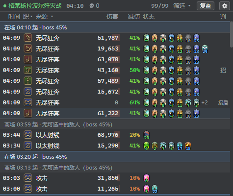
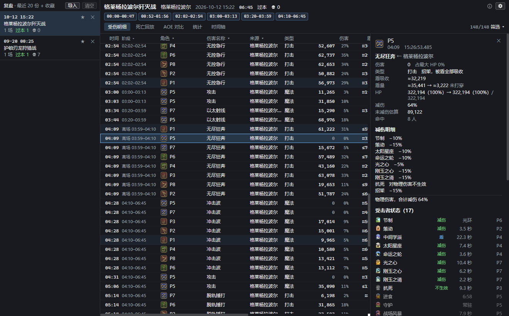
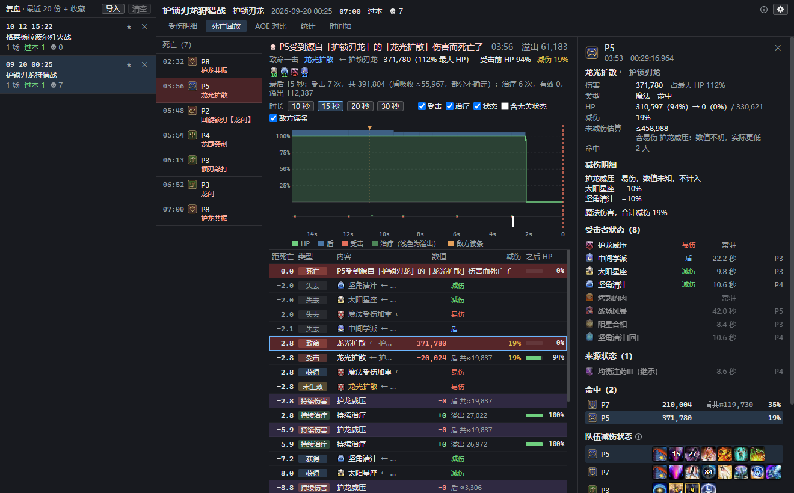
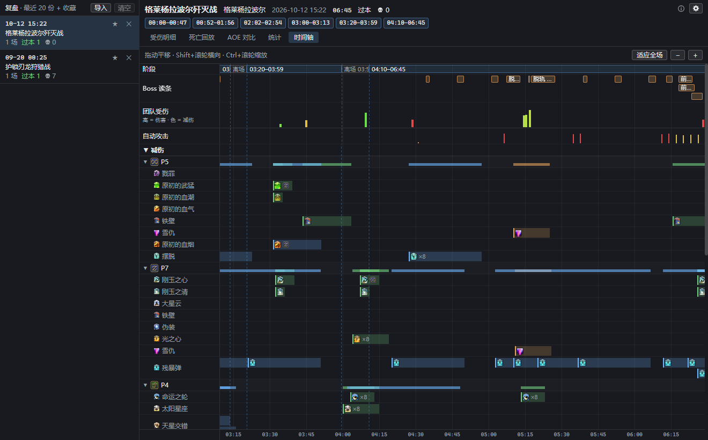

# Mitigation Monitoring · 小队减伤监控

FF14 的 ACT 悬浮窗，监控小队每个人受到的每一次伤害：当时开了哪些减伤、盾挡掉了多少、为什么死。打本时在悬浮窗里实时看，打完在复盘窗口里细看。



## 安装

1. 在 OverlayPlugin 里新建一个 MiniParse 类型的悬浮窗
2. URL 填：

   ```
   https://garfieldzasv.github.io/Mitigation-Monitoring/
   ```

3. 悬浮窗宽约 475px，高 300~400px
4. 关掉这个悬浮窗的「鼠标穿透 / Enable clickthru」，才能点工具栏的按钮、在悬浮窗上右键打开设置

不想依赖网络的话，到 [Releases](https://github.com/garfieldzasv/Mitigation-Monitoring/releases) 下载 zip 解压。较新的 OverlayPlugin 在 URL 输入框旁边有个 `...` 按钮，点它直接选中解压出来的 `index.html` 就行；老版本则手动填 `index.html` 的完整 `file://` 地址。本地和在线是同一份产物，图标都打包在里面，运行时不访问网络。

在普通浏览器里调试时，URL 后面加 `?OVERLAY_WS=ws://127.0.0.1:10501/ws`，通过 OverlayPlugin 的 WebSocket 服务连接 ACT（需要先在 OverlayPlugin 里开启）。

## 功能

右键或点工具栏的齿轮打开设置页，所有改动即时生效并自动保存。

### 监控窗口

* 每次受击一行，最新的在最上面：时间、职业、技能名、伤害、减伤率、受击时身上的状态、判定
* 伤害是扣掉盾之后的实际掉血；暴击标红，底色条是这一下占最大 HP 的比例
* 减伤率是受击那一刻生效的减伤连乘，悬停看逐项明细；有数值未知的减伤时带 `?`
* 状态图标上叠着剩余秒数，颜色区分减伤、盾、Boss 身上的减益、易伤和无敌；对这一下不生效的减伤显示为黑白
* 判定标出格挡、招架、闪避、被盾全吸收和无敌
* 死亡行写明谁被什么打死，右边的「回放」直接打开这次死亡的回放
* 按队员、伤害名称、来源、类型、判定过滤，可以隐藏自动攻击、0 伤害、持续伤害，或者设最小伤害
* Boss 离场时在工具栏标出来，列表按在场、离场分段
* 显示范围跟随 ACT 的解析范围：设为小队就显示 8 人，设为全团就显示全团

### 复盘窗口

工具栏的「复盘」打开，分五个标签页。

* 受伤明细：全部列，包括盾吸收、受击前后的 HP、未减伤估算。点一行，右侧看这一下的完整快照：减伤明细、受击者和来源身上的全部状态、同一次施放命中了谁，以及这一刻小队里每个人的减伤技能是生效中、冷却中还是转好了没用
* 死亡回放：死前 10~30 秒的 HP 和护盾曲线，受击、治疗、状态变化和敌方读条按时间列出
* AOE 对比：同一次 AOE 里每个人的伤害、盾量、穿盾，以及缺了哪些别人都有的减伤
* 统计：按队员、按伤害名称汇总
* 时间轴：Boss 读条、团队受伤、每个人施放的减伤和盾按时间对齐，看减伤有没有覆盖到伤害
* 减伤率、盾吸收、未减伤估算的来源和误差，见右上角的信息图标

受伤明细，右侧是选中这一下的详情：



死亡回放：



时间轴：



### 存档

* 自己或小队进入战斗才开始记录，每场的原始日志行存在 ACT 内置浏览器里
* 一次进本（或进入一张地图）的全部战斗是一份复盘，比如 24 人本的几个 boss；默认保留最近 20 份，收藏（★）的不删
* 复盘时从原始日志行重新计算，以后修正的减伤数值和算法，对旧记录同样生效
* 复盘窗口左上角的「导入」从 ACT 的网络日志（`%APPDATA%\Advanced Combat Tracker\FFXIVLogs\Network_*.log`）里选场次导入，导入的自动收藏
* 设置里可以选哪些区域不存档（默认只存副本），以及解除限制进入的副本要不要自动存档（默认不存）
* 不请求任何第三方地址，也没有统计代码

## 常见问题

**点不了按钮，右键没反应。** 确认「鼠标穿透 / Enable clickthru」是关闭的。打本时可以开着穿透只看，要点「复盘」、过滤或改设置时再关掉。

**换了地址，以前的复盘没了。** 在线地址和本地文件地址的设置、复盘存档互相独立，换回原来的地址就能看到。

**工具栏显示「不存档」。** 这一场只在监控窗口里显示，没有存成复盘：设置里这个区域不存档，或者是解除限制进入的副本，或者在复盘窗口里删掉了。想留下的话，打完从 ACT 的网络日志里「导入」，导入不受这两项设置限制。

**只显示了 8 个人。** 显示范围跟着 ACT 的解析范围（Parse Filter）走，设为全团就显示全团。

**盾吸收前面有「≈」「≥」，或者写着「?」。** 盾吸收量是从受击前后的护盾算出来的，误差约 1% 最大 HP；只知道下限或上限时写 `≥` / `≤`，定不出来时写 `?`。

**复盘窗口里，状态的剩余时间写着「光环」。** 节制、野战治疗阵、诗人的歌这类光环和地面技能，游戏每 3 秒左右给范围内的人补发一次，人会走进走出，所以没有确定的剩余时间。

其他问题和建议请 [开 issue](https://github.com/garfieldzasv/Mitigation-Monitoring/issues)。

## 构建

需要 Node.js 和 pnpm。

```bash
pnpm install
pnpm dev    # 浏览器打开 http://localhost:5173/，URL 加 ?OVERLAY_WS=ws://127.0.0.1:10501/ws 连接 ACT
pnpm test
pnpm e2e    # 构建，并用无头 Chrome 从 file:// 跑冒烟测试
```

游戏图标不在仓库里，打发布包需要本机的图标解包，流程见 [DESIGN.md](docs/DESIGN.md) 第 9.4、9.8 节。游戏数据用 `pnpm import-data` 重新生成（9.4）；测试夹具、检查脚本和在 ACT 里的运行环境实测见第 9.6、11.2 节。

## 许可与来源

MIT，见 [LICENSE](LICENSE)。

状态、技能和区域数据由 `scripts/import-game-data.ts` 从游戏客户端数据生成：国服数据来自 [ffxiv-datamining-cn](https://github.com/thewakingsands/ffxiv-datamining-cn)；自动攻击和死因的人工标注来自 [cactbot](https://github.com/OverlayPlugin/cactbot)（Apache-2.0）。

状态图标、技能图标和职业图标取自 FINAL FANTASY XIV。FINAL FANTASY 是 Square Enix Holdings Co., Ltd. 的注册商标，本项目与 Square Enix 无关联，也未获其背书。
